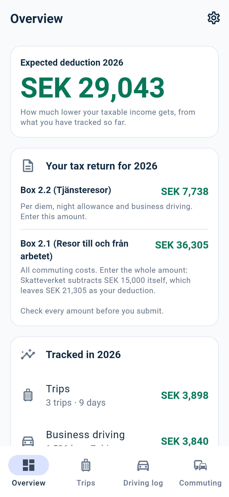
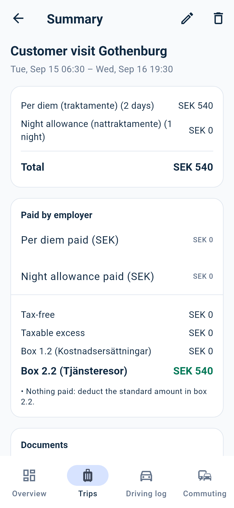
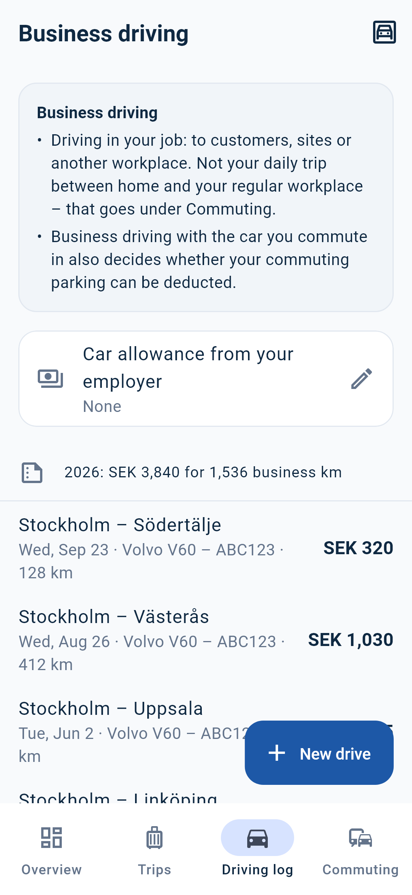
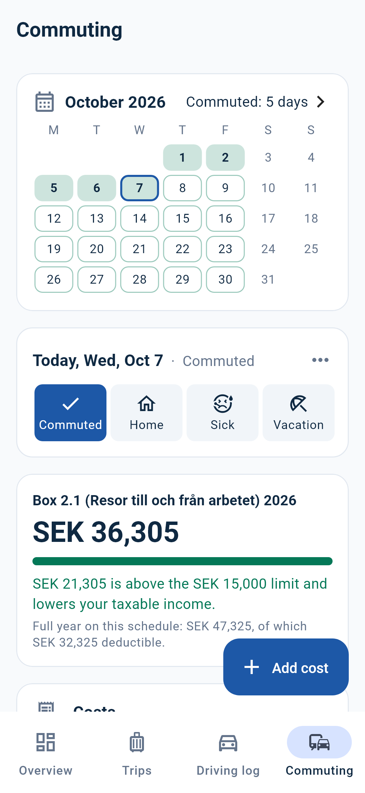

# Trakta

[](https://github.com/Dan-Irl/Trakta/actions/workflows/ci.yml)
[](https://github.com/Dan-Irl/Trakta/releases/latest)
[](LICENSE)
[](https://scorecard.dev/viewer/?uri=github.com/Dan-Irl/Trakta)

**A free, open source app for Swedish work travel deductions:** per diem (*traktamente*), business driving (*milersättning*) and commuting (*reseavdrag*). It runs entirely on your phone, with no account and no internet access, and shows the Skatteverket rule behind every amount.

<p>
  
  
  
  
</p>

## Download

- **Android:** [trakta.app/ladda-ner](https://trakta.app/ladda-ner/) ([English](https://trakta.app/en/download/)), or `trakta.apk` from the [latest release](https://github.com/Dan-Irl/Trakta/releases/latest). [Obtainium](https://obtainium.imranr.dev/) can install updates straight from this repository; the app itself never goes online to check.
- **iPhone:** later.
- **Google Play and App Store:** on the way ([road to the stores](docs/launch-checklist.md)).

Every APK is signed with the same release key. Its certificate SHA-256 is `20:EE:F0:03:4B:0B:29:D6:4E:3A:25:23:B8:9C:7D:27:D6:AD:91:DD:B8:97:B0:AD:EE:DB:A2:11:AA:2F:66:3E`. Each release lists the APK's checksum, and `gh attestation verify trakta.apk --repo Dan-Irl/Trakta` proves it was built by this repository's release workflow.

## Why Trakta

- **Offline:** the installed app makes no network requests. The Android release build ships without the `INTERNET` permission, and CI fails if that changes.
- **Local:** no accounts, backend or analytics. Your data lives in an encrypted SQLite file on your phone; an encrypted backup file moves it to a new phone (Android ↔ iPhone).
- **Explainable:** every amount comes with the rule that produced it and a link to Skatteverket's source.
- **No hard-coded tax numbers:** every amount, percentage, threshold and country rate lives in a per-income-year [rules pack](docs/rules-packs.md).
- **Open:** anyone can read exactly how the app calculates ([tax rules](docs/tax-rules.md)) and check the offline promise in the code.
- **Not tax advice:** the app shows Skatteverket's standard amounts and the rules it applied. It never tells the user what to file, and it has no connection to Skatteverket.

Out of scope: payroll, bookkeeping, filing the tax return and the employer's reporting duties (arbetsgivardeklaration).

## Features

Legend: ✅ done · 🚧 partial · ⬜ planned

**Per diem (traktamente)**
- ✅ Domestic trips with eligibility checks (ordered trip, >50 km, night worker)
- ✅ Full/half days, night allowance, meal reductions (8 meal statuses)
- ✅ Meals and lodging for the whole trip (e.g. hotel breakfast, hotel paid by employer), changeable per day
- ✅ New trips start with the employer setup of the latest trip (per diem paid or not, lodging, meals)
- ✅ Two-step trip creation: details, then review and adjust every day before saving
- ✅ Notes and documents per trip (tickets, booking confirmations, receipts as PDF or images), stored only on the phone and opened in the phone's own viewer. Commuting costs and business drives take documents too (invoices, toll and parking receipts)
- ✅ Per-day review: meals and lodging (standard/receipt/employer)
- ✅ Employer payments: tax-free vs. taxable excess, Box 1.2 / 2.2
- ✅ Sole-trader deduction basis (enskild firma)
- ✅ Foreign trips: country for the whole trip (searchable, with flags) and per-day changes, using Skatteverket's normalbelopp
- ⬜ Border crossings with times (exact country per day from a timeline)
- ⬜ Three-month and two-year long-stay reductions (see [Not supported yet](docs/tax-rules.md#not-supported-yet))

**Business driving (tjänstekörning, milersättning, box 2.2)**
- ✅ Driving log (körjournal) with odometer or distance
- ✅ Vehicles: own/company car, fossil/plug-in hybrid/electric, fuel and charging flags
- ✅ Distance or odometer readings per drive; congestion tax and tolls; yearly totals
- ✅ Employer car allowance as a rate per mil, set once and copied onto each new drive (changeable per drive)

**Commuting (reseavdrag, resor till och från arbetet, box 2.1)**
- ✅ Routes with a weekly schedule: commuting days are the schedule minus Swedish public holidays, days away on business trips and days marked off (vacation, sick, home office)
- ✅ Standard amount per mil by car, the 5 km rule and the 15 000 kr limit (2026)
- ✅ Costs: congestion tax per invoice, road/bridge/ferry fees and parking, once, monthly or per commuting day
- ✅ Parking counts only after enough business driving with the same car (300 mil over 60 or 160 days), with the progress shown
- ✅ "So far" up to today plus a full-year projection from the schedule
- ⬜ Public transport and bicycle

**Overview**
- ✅ Start screen: expected deduction for the income year from trips, business driving and commuting (the part above the limit)

**App**
- ✅ Offline, no network permission, encrypted local database
- ✅ Swedish and English, with official Swedish terms and a glossary
- ✅ "Why?" explanation for every amount
- ✅ Theme and app icon (see [design/DESIGN.md](design/DESIGN.md))
- ✅ Encrypted backup and restore for switching phones (Android ↔ iPhone): one password-protected `.trakta` file with all data and documents, saved as a file anywhere on the phone (system save dialog) or shared straight to Drive, email or another app; restore from Settings or straight from the welcome pages
- ⬜ PDF/CSV export (reseräkning, körjournal, year summary)
- ✅ Version, update channel, source code link and open-source licences under Settings
- ✅ Signed APK on GitHub releases, with checksums and build provenance
- ⬜ Google Play and App Store (see [Road to the stores](docs/launch-checklist.md))

## Build from source

You need the Flutter SDK (the exact version is in [`.fvmrc`](.fvmrc); [FVM](https://fvm.app) picks it up) and Git.

```sh
git clone https://github.com/Dan-Irl/Trakta.git
cd Trakta
dart tool/bin/dev.dart          # pub get, code generation, analyze, all tests and checks
cd apps/trakta_app
flutter run
```

On Windows, `powershell -ExecutionPolicy Bypass -File tool\dev.ps1` does the same as `dart tool/bin/dev.dart`, and in VS Code F5 runs "Trakta (debug)". Run `flutter` commands inside `apps/trakta_app`; `flutter run` from the repository root fails.

A build from source shows "Built from source" under Settings. If you publish a modified version, give it your own name, icon and app ID ([trademark policy](TRADEMARKS.md)).

## Documentation

| Document | What it covers |
| --- | --- |
| [docs/tax-rules.md](docs/tax-rules.md) | The rules the engine applies, with Skatteverket sources, open questions and what is not supported yet |
| [docs/architecture.md](docs/architecture.md) | Repository layout, layers, encryption, backups, tests, design and languages |
| [docs/rules-packs.md](docs/rules-packs.md) | The per-year rules packs and the yearly update before 1 January |
| [docs/releasing.md](docs/releasing.md) | Release channels, signing keys, the release workflow and its setup |
| [docs/store-listing.md](docs/store-listing.md) | Store and app catalogue texts |
| [docs/launch-checklist.md](docs/launch-checklist.md) | What is left before Google Play production and the App Store |
| [design/DESIGN.md](design/DESIGN.md) | Colours, type, components and the app icon |
| [website/README.md](website/README.md) | trakta.app |
| [AGENTS.md](AGENTS.md) | The rules for changes, written for AI coding agents and just as useful for people |

## Status

Version 1.0.0 went to testers on Google Play in October 2026. 1.1.0 is the first open source release, with the Android app downloadable from GitHub. Next: testing on more phones, the 2027 rules pack, PDF/CSV export, border crossings, then Google Play production. See [CHANGELOG.md](CHANGELOG.md).

## Contributing

Bug reports, corrections of tax rules (with a Skatteverket source) and pull requests are welcome. Start with [CONTRIBUTING.md](CONTRIBUTING.md). Everyone taking part follows the [code of conduct](CODE_OF_CONDUCT.md). Report security problems privately ([SECURITY.md](SECURITY.md)). Questions: [SUPPORT.md](SUPPORT.md).

If Trakta saves you time, you can [buy the developer a coffee](https://buymeacoffee.com/danjohansson).

## License

Trakta is licensed under the [Apache License 2.0](LICENSE). The name "Trakta", the logo and the app icon are trademarks; see the [trademark policy](TRADEMARKS.md) for what you may do with them. Trakta has no connection to Skatteverket (the Swedish Tax Agency), and it is not tax advice: you are responsible for your own tax return.
